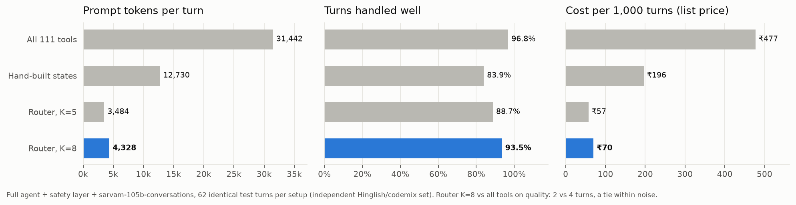
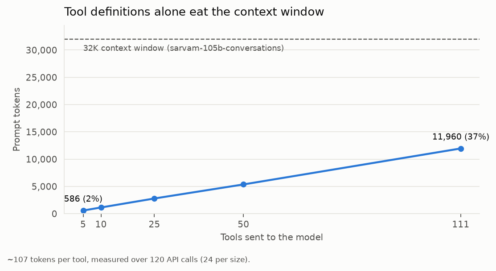
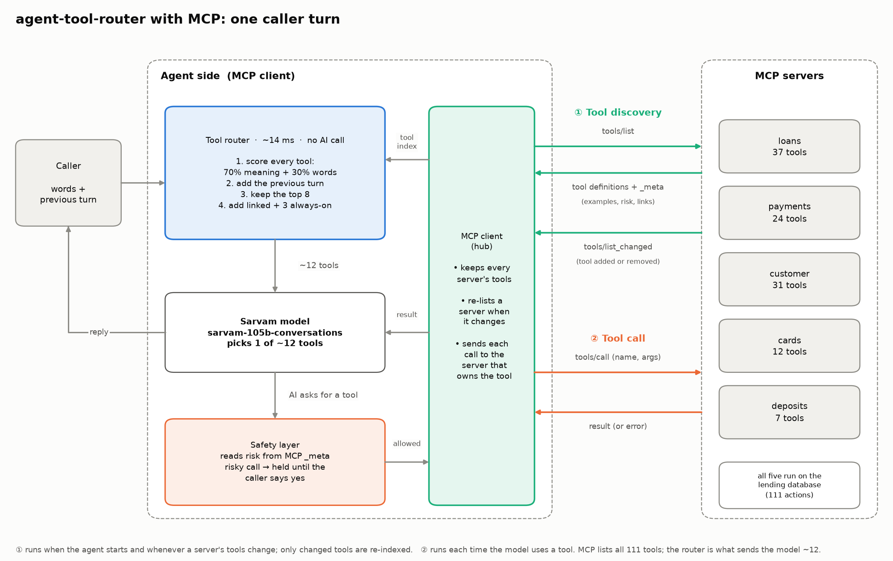
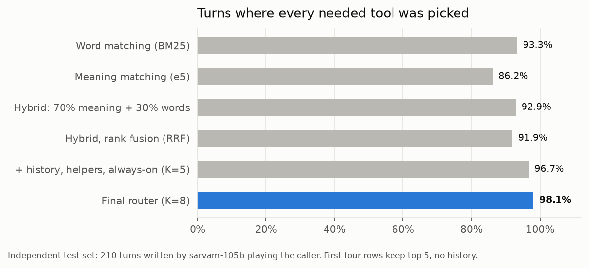
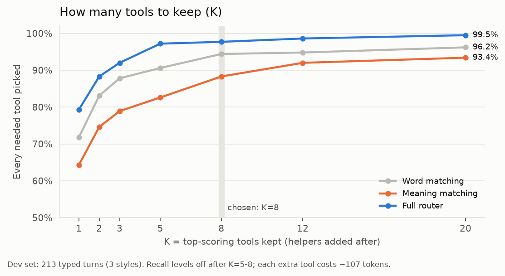
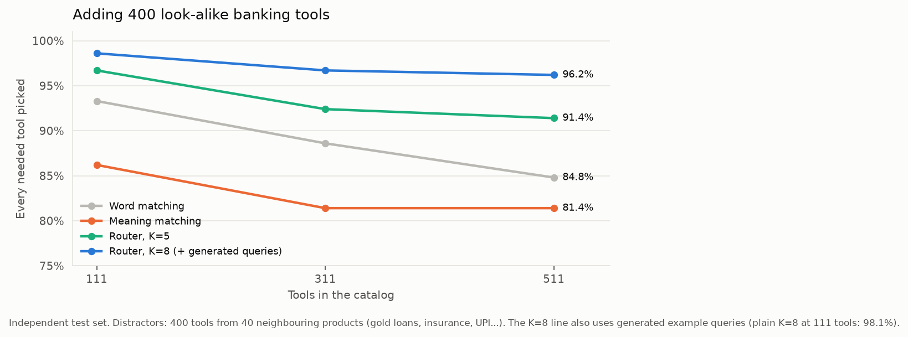

# agent-tool-router

**Letting an AI agent use 100+ tools without sending all of them on every turn.**

I built a lending-company agent with 111 tools on Sarvam's APIs (`sarvam-105b-conversations`), then built a small router that shows the model only the ~12 tools each turn actually needs. I tested it against sending everything, and against hand-built "states" (the way tools are scoped on Sarvam's voice-agent platform today), on Hindi, Hinglish and English conversations.



> ### The short version
> - **86% fewer prompt tokens per turn** (4,328 vs 31,442) with the full agent running on `sarvam-105b-conversations`.
> - **Same quality as sending all 111 tools.** 93.5% vs 96.8% of turns handled well; turn by turn the difference was 2 turns vs 4, which is a tie at this sample size.
> - **6.8× cheaper per turn at list price** (₹70 vs ₹477 per 1,000 turns) and **29% faster** typical turns (0.98 s vs 1.38 s).
> - **Beats hand-built states**, even perfect ones: 98.1% of turns get every needed tool vs 95.7%, with **~3× fewer tool tokens**.
> - **Holds up at 511 tools:** 96.2% when 400 look-alike banking tools are added, while plain keyword search drops to 84.8%.
> - **Routing adds ~14 ms** per turn. No extra model call.
> - **A code-level safety layer caught the model quoting the wrong payment amount** (₹27,076 instead of ₹28,076) before any money moved.

---

## Why I built this

Tool calling works well with five tools. With a hundred, three things go wrong.

1. **Every model call re-sends every tool definition.** Each tool costs about 107 tokens, so 111 tools is ~12,000 tokens before the caller has said anything. That's 37% of the 32K context window of `sarvam-105b-conversations`.
2. **A turn is usually 2–3 model calls** (pick a tool, maybe another, then speak), so the same 12,000 tokens go out two or three times per turn.
3. **Scoping tools by hand doesn't scale.** On Sarvam's platform today, a developer groups tools into states and wires up transitions. With 100+ tools that's a lot of manual design, and a caller who asks about two things at once falls between states.

I picked **loan servicing** as the domain because it's where Sarvam's voice agents are actually used (Tata Capital is their named lending customer), and because it has every kind of risk in one place: look-ups, changes, payments, private data, and actions you can't undo.



---

## What's in the repo

```
Caller's words
   │
   ├─ router/      picks ~12 of the 111 tools for this turn (hybrid search + conversation + tool links)
   ├─ agent/       talks to sarvam-105b-conversations, runs the tools, retries rate limits
   ├─ safety/      decides in code whether a risky tool may run (confirmations, exact amounts, masking)
   └─ backend/     a fake lending company: 50 customers, 82 loans, cards, deposits, 111 actions
```

| Part | What it is |
|---|---|
| `backend/` | SQLite lending company with realistic rules (wrong EMI amount is rejected, collection calls only 8 am–7 pm…), plus a failure switch for testing outages |
| `tools/catalog.py` | 111 tool definitions, each with a risk level, three example phrases (Hinglish, Hindi, English), and links to the tools it depends on |
| `router/` | The tool picker, every technique I tried as a switch, the hand-built states baseline |
| `agent/` | The conversation loop and the Sarvam client |
| `safety/` | Confirmations, yes/no in three languages, PII masking, loan-promise filter, audit log |
| `eval/` | Test scenarios, generated test sets, and every experiment script |
| `results/`, `docs/charts/` | Saved results and the charts in this README |

---

## Architecture



The agent side is an MCP client. The router shortlists about 12 tools for each turn, Sarvam's model picks one, and the safety layer decides whether it may run. The MCP client then sends the call to the server that owns that tool.

Two kinds of traffic go between the client and the five MCP servers:

1. **Tool discovery.** The client asks each server for its tools (`tools/list`) and gets back their definitions, with examples, risk level and linked tools in `_meta`. When a server adds or removes a tool, it says so (`tools/list_changed`), and only the changed tools are re-indexed.
2. **Tool call.** Each time the model uses a tool, the client sends `tools/call` with the name and arguments, and the server sends back the result or an error.

---

## How the router works

The router's job is not to pick *the* tool. It picks a short list, about 12 tools, that almost certainly contains the right one, and the model chooses from that list. Missing the right tool breaks the call; an extra tool only costs ~107 tokens. So the router is built to not leave things out.

It has two parts: a setup that runs once, and a routing step that runs on every caller turn.

### Part 1: Setup (once, ahead of time)

**1. Describe every tool.**
Each of the 111 tools gets a short card: its name, what it does, the inputs it needs, and three example phrases showing how callers ask for it (Hinglish, Hindi and English). The examples matter: meaning search scored 82.6% with them and 74.6% without.

**2. Link tools that go together.**
Some tools are recorded with:
- **needs**: tools that must come first. To close a loan, the caller first has to hear the quote; to dispute a charge, the agent first needs the transaction list.
- **next**: tools usually used right after. After checking an EMI, people often pay it.

28 tools have links like these (`tools/catalog.py`).

**3. Build a word index.**
Record which words appear on which cards (BM25). Rare words like "hypothecation" count as strong clues; common words like "loan" count as weak ones.

**4. Build a meaning index.**
A small multilingual model (`multilingual-e5-small`, running locally) turns each card into a list of numbers that captures its meaning. Cards about similar things end up with similar numbers, whatever the language or wording.

**5. Save it.**
Both indexes are saved. Each card's numbers are stored with a fingerprint of its text, so when a tool is added or edited, only that tool is processed again. Nobody has to redesign a flow when a tool is added.

### Part 2: Routing (every caller turn, ~14 ms)

**1. Take two inputs.**
- what the caller just said
- the previous turn: what the caller said before, plus the agent's reply

**2. Word score.**
Every tool gets a score for how many of the caller's words appear on its card, with rare words counting more. This catches exact terms like EMI, NOC or RC.

**3. Meaning score.**
The caller's words are turned into numbers, and every tool gets a score for how close its meaning is. This catches the same request said differently, in any script.

**4. Blend.**
The two scores are combined for each tool:

> **70% meaning + 30% words**

Each catches what the other misses. In testing, this blend beat both a 50/50 blend and rank fusion (RRF).

**5. Add the previous turn.**
Steps 2–4 are repeated on the previous turn, and that score is added to each tool:
- normally at **half weight**
- at **1.5× weight when the caller said four words or fewer**, because short replies like "personal wala" or "haan wahi" only make sense with what came before

This took follow-up replies from 69% to 94% on the dev set.

**6. Keep the top 8.**
All 111 tools are sorted by final score and the best **8** are kept. The number came from testing 1, 2, 3, 5, 8, 12 and 20: at 5, some right tools fall just outside the list; above 8, gains are tiny and every extra tool adds ~107 tokens.

**7. Add linked tools.**
For each of the 8, its **needs** and **next** tools from setup step 2 are added if they aren't already there. Multi-step requests went from 33% to 100% with this.

**8. Add three always-on tools.**
- list the caller's loans
- list the caller's products
- transfer to a human

Callers never say loan IDs, so the agent almost always needs to look them up first, and a human handover should always be possible.

**9. Send the list.**
Only these ~12 tools go to `sarvam-105b-conversations` for this turn: about 1,300 tokens instead of ~12,000. The model chooses which one to use, and the safety layer (below) decides whether it's allowed to run.

### Two rules around it

- **The list stays the same for the whole turn.** Even if the model calls two or three tools in a row (look up the loans, then get the EMI), they all come from this list. That's why linked tools are added up front.
- **The next turn starts fresh.** The router runs again from step 1, so if the caller changes topic, the new topic's tools come in.

### Tools served over MCP

The 111 tools can also run behind MCP servers, which is how large tool sets usually show up in practice. They're split across five servers (loans 37, payments 24, customer 31, cards 12, deposits 7). The router connects as an MCP client, lists every server's tools, indexes them, and sends each tool call to the server that owns it.

- **Same results:** fed by MCP, the router picks identical tool lists to the in-process version on all 423 test turns.
- **Tools can change while it runs:** a server announces new or removed tools, and the router re-indexes only what changed. In testing, a new tool was announced in about 0.5 s, needed one new embedding, and was routable on the next turn.
- **Safety still applies:** each tool carries MCP's read-only and destructive hints plus its risk level in `_meta`. Tools with no risk level need the caller's yes by default.
- **MCP doesn't save tokens by itself:** `tools/list` still returns every definition. The router is what keeps each call to about 12 tools.

```bash
python -m eval.mcp_check          # 15 checks, free
python -m eval.mcp_check --live   # adds a short real conversation (a few paise)
```

### What it deliberately doesn't do

- **No extra model call.** Asking the model to rewrite unclear requests reached the same accuracy but added up to 0.6 s on half the turns.
- **No topic-first step.** Choosing a topic first and then tools inside it did worse, because a wrong topic guess loses every tool.
- **No sentence splitting.** Two requests in one sentence ("EMI kab hai aur card ka bill kitna?") already worked 100% of the time without it.

**In one line:** score every tool by words + meaning, add the previous turn (more for short replies), keep the top 8, add their linked tools and three always-on tools, and send only those to the model.

---

## Results

All numbers come from saved runs in `results/`. Two test sets were used for the router comparisons:

- **Dev set:** 213 turns I typed myself (71 scenario turns in three styles). I used this to build things.
- **Independent set:** 210 turns written by `sarvam-105b`, playing the caller from the same scenario cards. It never saw tool names or my sentences. Treat this one as the real test.

### 1. Which narrowing techniques work



Retrieval on its own (top 5, no conversation context), as % of turns where every needed tool was picked:

| Technique | Dev set | Independent set |
|---|---|---|
| Random 5 tools (floor) | 7.0% | — |
| Word matching (BM25) | 90.6% | **93.3%** |
| Meaning matching, MiniLM | 72.3% | — |
| Meaning matching, e5-small | 82.6% | 86.2% |
| Meaning matching without example phrases in the cards | 74.6% | — |
| Hybrid, 70% meaning + 30% words | **92.0%** | 92.9% |
| Hybrid, 50/50 | 91.5% | — |
| Hybrid, rank fusion (RRF) | 88.7% | 91.9% |
| Topic first, then tools ("automatic states") | 81.7% | — |
| Generated example queries appended (Re-Invoke style), words | 88.7% | 91.9% |
| Generated example queries appended, meaning | 84.5% | 88.1% |
| Generated queries as separate vectors, hybrid | 93.0% | 93.8% |

Something I didn't expect: on the independent set, the hybrid on its own is no better than plain word matching (92.9% vs 93.3%). Where the hybrid earns its place is **at scale** (section 3) and inside the full pipeline. Example phrases in the tool cards mattered a lot (+8 points for meaning search).

Adding the conversation-aware pieces on top (dev set):

| Pipeline step | Every needed tool picked | Tools sent | Tool tokens |
|---|---|---|---|
| Hybrid, top 5 | 92.0% | 5 | 549 |
| + previous turn | 93.4% | 5 | 548 |
| + sentence splitting ("X aur Y") | 92.5% | 5.2 | 569 |
| + linked tools | 94.8% | 6.3 | 677 |
| + always-on tools | 94.8% | 9.2 | 952 |
| + short-reply boost, no splitting | **97.2%** | 9.1 | 930 |
| + adaptive K instead of 5 | 95.3% | 10.0 | 1,039 |

By type of request, the linked tools took chains (dispute → transaction list) from **33% to 100%**, and the short-reply boost took follow-ups like "aur personal wale ka?" from **69% to 94%**.

### 2. Choosing how many tools to keep



| K | Full router (dev) | Full router (independent) | Tool tokens |
|---|---|---|---|
| 3 | 92.5% | 92.4% | 687 |
| 5 | 97.2% | 96.7% | 930 |
| **8** | **97.7%** | **98.1%** | **1,302** |
| 12 | 98.6% | — | ~1,500 |
| 20 | 99.5% | — | ~2,500 |

The K=3 row also uses generated example queries; the K=12 and K=20 rows come from a sweep without the three always-on tools, so their token counts are a little lower than the full router would send.

I started with K=5 because the papers did. The data said 8: an extra tool costs ~107 tokens, a missing tool breaks the call. End to end, K=8 also beat K=5 (93.5% vs 88.7%).

### 3. Scaling to bigger catalogs



I generated 400 extra tools from 40 neighbouring banking products (gold loans, insurance, UPI, lockers…) to see what happens in a big bank.

| Method | 111 tools | 311 tools | 511 tools |
|---|---|---|---|
| Word matching | 93.3% | 88.6% | 84.8% |
| Meaning matching | 86.2% | 81.4% | 81.4% |
| Router, K=5 | 96.7% | 92.4% | 91.4% |
| **Router, K=8 (+ generated queries)** | **98.6%** | **96.7%** | **96.2%** |

### 4. The full agent, end to end

This is the test that matters most: the whole agent (selection + safety layer + `sarvam-105b-conversations`) on 62 independent turns in codemix (Devanagari + English, like Saaras speech-to-text output). All four setups ran on exactly the same turns. For states, the model switched topics itself by calling `go_to_<topic>`, as on Sarvam's platform.

| Setup | Handled well* | Acted this turn | Right details (loan, amount, date) | Prompt tokens / turn | Model calls / turn | Typical turn | Slow turn (p95) | ₹ per 1,000 turns | Asked caller for an ID | Wrong actions |
|---|---|---|---|---|---|---|---|---|---|---|
| All 111 tools | 96.8% | 74.2% | 93.8% | 31,442 | 2.52 | 1.38 s | 2.55 s | 477 | 3 | 1 |
| States (model switches) | 83.9% | 64.5% | 88.5% | 12,730 | 2.69 | 1.27 s | 2.58 s | 196 | 9 | 2 |
| Router, K=5 | 88.7% | 64.5% | 91.7% | 3,484 | 2.31 | 1.26 s | 2.29 s | 57 | 9 | 0 |
| **Router, K=8** | **93.5%** | 67.7% | **96.0%** | **4,328** | **2.29** | **0.98 s** | **2.23 s** | **70** | 5 | **0** |

\*"Handled well" means the agent called the right tool, **or** asked a sensible question ("which loan?", "shall I go ahead?") without doing anything wrong and without asking the caller for an internal ID. My first scoring only counted "acted this turn", which marked good behaviour like confirming before a payment as failure; I re-scored from the saved runs.

One thing surprised me. In isolation, a single model call barely gets slower with more tools (+70 ms from 5 to 111 tools). But real turns carry history and tool results and need fewer calls with the router, so **whole turns were 29% faster**.

### 5. Safety

The router decides what the model can *see*. A separate layer decides, in code, what is allowed to *run*:

| Tool risk | Rule |
|---|---|
| Read | Runs |
| Write / private data | Needs the caller's yes to exactly this call |
| Payment | Needs a yes to the **exact amount**, which code calculates |
| Irreversible | Its prerequisite must have run (no foreclosure without the quote), then the system's own warning and a yes |

Also: yes/no understanding in Hinglish, Hindi and English (mixed answers like "haan… nahi ruko" mean ask again), phone/PAN/account masking for the model and the logs, a filter on loan promises, retries for rate limits and server errors, and an audit trail. 41 automated checks pass without calling the model.

Two things I learned live:

- **The model got a payment amount wrong.** It offered to clear overdue EMIs for ₹27,076; with late fees the real charge was ₹28,076. The read-back amount is calculated by code, so the caller heard the true figure before agreeing.
- **A prompt couldn't stop double confirmations.** The model kept asking "shall I?" itself, and then the safety layer asked again. Telling it not to didn't work, so it's now a rule in code: a yes to the model's own question counts for simple changes, counts for payments only if it stated the exact amount, and never counts for irreversible actions.

```
Agent: Do overdue EMI hain, 27,076 rupees total. UPI se pay kar doon?
Ravi:  Haan kar do
Agent: Total amount 28,076 rupees hoga, late fees bhi included hai. Proceed kar doon?
Ravi:  Haan
Agent: 28,076 rupees ka payment successful ho gaya hai.
```

---

## What didn't work

I think these are as useful as the wins.

| Idea | Result | Why I dropped it |
|---|---|---|
| Ask the model to rewrite the request when the router is unsure (Re-Invoke style cascade) | K=5 + rewrite: 98.6% with 1,023 tool tokens. K=8 alone: 98.1–98.6% with 1,302 | Fires on 52% of turns and adds ~233 ms typical, ~621 ms worst case. On a phone call, keeping 8 tools is the better trade |
| Rank fusion (RRF) | 88.7% / 91.9% vs 92.0% / 92.9% for weighted | Simply worse here |
| Topic first, then tools | 81.7% vs 82.6% | A wrong topic guess loses every tool |
| Splitting "X aur Y" into parts | 95.8% vs 97.2% without | The hybrid already got 100% on two-part requests |
| Adaptive K | +0.5 points for +87 tokens | Not worth it |
| Generated example queries per tool | Small and inconsistent gains | Optional, not core |

---

## Where this falls short

- **No voice yet.** The agent is text-in, text-out; there is no speech-to-text → agent → text-to-speech loop or phone integration yet.
- **The agent sometimes asks callers for a "card ID" or "loan ID"** instead of looking it up, in every setup. Probably a prompt fix; not re-tested.
- **One fake company, one industry.** The router was tuned on my own dev sentences; the short-reply boost in particular was designed after looking at failures there.

---

## Running it

```bash
python3 -m venv ~/.venvs/loan-agent
source ~/.venvs/loan-agent/bin/activate
pip install -r requirements.txt
cp .env.example .env              # add your Sarvam API key
python -m backend.seed            # build the fake lending company
```

| What | Command |
|---|---|
| Check the backend (129 checks) | `python -m scripts.smoke_backend` |
| Check tools and scenarios | `python -m scripts.check_tools` and `python -m scripts.check_scenarios` |
| Safety checks (41) | `python -m scripts.test_safety` |
| Compare narrowing techniques | `python -m eval.router_eval`, `python -m eval.research_eval` |
| States vs router | `python -m eval.states_eval` |
| Redraw the charts | `python -m eval.make_charts` |
| Talk to the agent | `python -m scripts.chat --customer C001` |
| Full end-to-end benchmark | `python -m eval.e2e_eval --dry-run`, then without `--dry-run` |
| Re-score saved end-to-end runs | `python -m eval.e2e_rescore` |

---

## References

- Mudunuri et al., *Semantic Tool Discovery for Large Language Models: A Vector-Based Approach to MCP Tool Selection* (2026), [arXiv:2603.20313](https://arxiv.org/abs/2603.20313)
- Franko, *Instruction-Tool Retrieval (ITR)* (2026), [arXiv:2602.17046](https://arxiv.org/abs/2602.17046)
- *Re-Invoke: Tool Invocation Rewriting for Zero-Shot Tool Retrieval*, Findings of EMNLP 2024, [arXiv:2408.01875](https://arxiv.org/abs/2408.01875)
- *Retrieval Models Aren't Tool-Savvy: Benchmarking Tool Retrieval for LLMs* (ToolRet), Findings of ACL 2025, [arXiv:2503.01763](https://arxiv.org/abs/2503.01763)
- *Towards Completeness-Oriented Tool Retrieval for LLMs* (COLT), [arXiv:2405.16089](https://arxiv.org/abs/2405.16089)
- *MCP-Zero: Active Tool Discovery for Autonomous LLM Agents*, [arXiv:2506.01056](https://arxiv.org/abs/2506.01056)
- Sarvam AI docs: [chat completions](https://docs.sarvam.ai/api/api-guides-tutorials/chat-completion/overview), [pricing](https://docs.sarvam.ai/api/getting-started/pricing), [voice agent tools](https://docs.sarvam.ai/voice-agents/build/tools), [multi-state agents](https://docs.sarvam.ai/voice-agents/build/states-conversation-flow)
