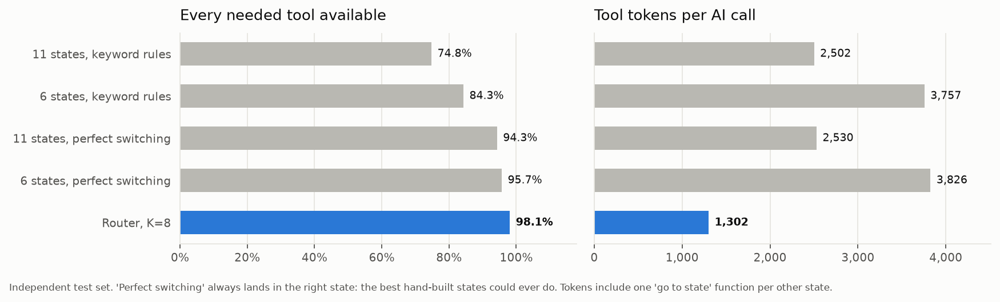

# Loan Agent Router

**Letting a Sarvam voice agent use 100+ tools without sending all of them on every turn.**

I built a lending-company voice agent with 111 tools on Sarvam's APIs, then built a small router that shows the model only the ~12 tools each turn actually needs. I tested it against sending everything, and against hand-built "states" (the way tools are scoped on Sarvam's platform today), on Hindi, Hinglish and English conversations.


> ### The short version
> - **86% fewer prompt tokens per turn** (4,328 vs 31,442) with the full agent running on `sarvam-105b-conversations`.
> - **Same quality as sending all 111 tools.** 93.5% vs 96.8% of turns handled well; turn by turn the difference was 2 turns vs 4, which is a tie at this sample size.
> - **6.8× cheaper per turn at list price** (₹70 vs ₹477 per 1,000 turns) and **29% faster** typical turns (0.98 s vs 1.38 s).
> - **Beats hand-built states**, even perfect ones: 98.1% of turns get every needed tool vs 95.7%, with **~3× fewer tool tokens**.
> - **Holds up at 511 tools:** 96.2% when 400 look-alike banking tools are added, while plain keyword search drops to 84.8%.
> - **Routing adds ~14 ms** per turn. No extra model call.
> - **A code-level safety layer caught the model quoting the wrong payment amount** (₹27,076 instead of ₹28,076) before any money moved.

---

## Why I built this

Tool calling works well with five tools. With a hundred, three things go wrong.

1. **Every model call re-sends every tool definition.** Each tool costs about 107 tokens, so 111 tools is ~12,000 tokens before the caller has said anything. That's 37% of the 32K context window of `sarvam-105b-conversations`.
2. **A turn is usually 2–3 model calls** (pick a tool, maybe another, then speak), so the same 12,000 tokens go out two or three times per turn.
3. **Scoping tools by hand doesn't scale.** On Sarvam's platform today, a developer groups tools into states and wires up transitions. With 100+ tools that's a lot of manual design, and a caller who asks about two things at once falls between states.

I picked **loan servicing** as the domain because it's where Sarvam's voice agents are actually used (Tata Capital is their named lending customer), and because it has every kind of risk in one place: look-ups, changes, payments, private data, and actions you can't undo.


---

## What's in the repo

```
Caller's words
   │
   ├─ router/      picks ~12 of the 111 tools for this turn (hybrid search + conversation + tool links)
   ├─ agent/       talks to sarvam-105b-conversations, runs the tools, retries rate limits
   ├─ safety/      decides in code whether a risky tool may run (confirmations, exact amounts, masking)
   └─ backend/     a fake lending company: 50 customers, 82 loans, cards, deposits, 111 actions
```

| Part | What it is |
|---|---|
| `backend/` | SQLite lending company with realistic rules (wrong EMI amount is rejected, collection calls only 8 am–7 pm…), plus a failure switch for testing outages |
| `tools/catalog.py` | 111 tool definitions, each with a risk level, three example phrases (Hinglish, Hindi, English), and links to the tools it depends on |
| `router/` | The tool picker, every technique I tried as a switch, the hand-built states baseline |
| `agent/` | The conversation loop and the Sarvam client |
| `safety/` | Confirmations, yes/no in three languages, PII masking, loan-promise filter, audit log |
| `eval/` | Test scenarios, generated test sets, and every experiment script |
| `results/`, `docs/charts/` | Saved results and the charts in this README |

More detail: [flow.md](flow.md) walks through the code, [decisions.md](decisions.md) explains every decision and why, [explained.md](explained.md) tells the whole story in short chapters, [costs-and-caching.md](costs-and-caching.md) covers what the savings mean for Sarvam, and [NOTES.md](NOTES.md) is the raw lab notebook. For sharing: [docs/one-pager.md](docs/one-pager.md) and [docs/resume-and-outreach.md](docs/resume-and-outreach.md).

---

## How the router works

**Once, ahead of time:** each tool gets a short "card" (name, description, three example phrases, parameters). The cards go into a keyword index (BM25) and a meaning index (`multilingual-e5-small` embeddings, running locally). Embeddings are cached by a hash of each card, so adding or editing a tool only re-embeds that one tool.

**On every caller turn (~14 ms):**

1. **Score every tool by words and by meaning,** blended 70% meaning and 30% words. Words catch exact terms like EMI, NOC or RC. Meaning catches paraphrases across scripts.
2. **Add the previous turn's score** at half weight, or 1.5× when the caller said four words or fewer. "Personal wala" means nothing on its own; after "Agli EMI kab hai?" it clearly means the personal-loan EMI.
3. **Keep the top 8.**
4. **Add each pick's linked tools.** Disputing a charge needs the transaction list; paying an EMI needs the EMI amount; closing a loan needs the quote. 28 tools have links like these.
5. **Add three always-on tools:** list loans, list products, transfer to a human.

The model sees about 12 tools. The set stays fixed for the turn and is chosen fresh on the next turn.

---

## Results

All numbers come from saved runs in `results/`. Two test sets were used for the router comparisons:

- **Dev set:** 213 turns I typed myself (71 scenario turns in three styles). I used this to build things.
- **Independent set:** 210 turns written by `sarvam-105b`, playing the caller from the same scenario cards. It never saw tool names or my sentences. Treat this one as the real test.

### 1. Which narrowing techniques work


Retrieval on its own (top 5, no conversation context), as % of turns where every needed tool was picked:

| Technique | Dev set | Independent set |
|---|---|---|
| Random 5 tools (floor) | 7.0% | — |
| Word matching (BM25) | 90.6% | **93.3%** |
| Meaning matching, MiniLM | 72.3% | — |
| Meaning matching, e5-small | 82.6% | 86.2% |
| Meaning matching without example phrases in the cards | 74.6% | — |
| Hybrid, 70% meaning + 30% words | **92.0%** | 92.9% |
| Hybrid, 50/50 | 91.5% | — |
| Hybrid, rank fusion (RRF) | 88.7% | 91.9% |
| Topic first, then tools ("automatic states") | 81.7% | — |
| Generated example queries appended (Re-Invoke style), words | 88.7% | 91.9% |
| Generated example queries appended, meaning | 84.5% | 88.1% |
| Generated queries as separate vectors, hybrid | 93.0% | 93.8% |

Something I didn't expect: on the independent set, the hybrid on its own is no better than plain word matching (92.9% vs 93.3%). Where the hybrid earns its place is **at scale** (section 3) and inside the full pipeline. Example phrases in the tool cards mattered a lot (+8 points for meaning search).

Adding the conversation-aware pieces on top (dev set):

| Pipeline step | Every needed tool picked | Tools sent | Tool tokens |
|---|---|---|---|
| Hybrid, top 5 | 92.0% | 5 | 549 |
| + previous turn | 93.4% | 5 | 548 |
| + sentence splitting ("X aur Y") | 92.5% | 5.2 | 569 |
| + linked tools | 94.8% | 6.3 | 677 |
| + always-on tools | 94.8% | 9.2 | 952 |
| + short-reply boost, no splitting | **97.2%** | 9.1 | 930 |
| + adaptive K instead of 5 | 95.3% | 10.0 | 1,039 |

By type of request, the linked tools took chains (dispute → transaction list) from **33% to 100%**, and the short-reply boost took follow-ups like "aur personal wale ka?" from **69% to 94%**.

### 2. Choosing how many tools to keep


| K | Full router (dev) | Full router (independent) | Tool tokens |
|---|---|---|---|
| 3 | 92.5% | 92.4% | 687 |
| 5 | 97.2% | 96.7% | 930 |
| **8** | **97.7%** | **98.1%** | **1,302** |
| 12 | 98.6% | — | ~1,500 |
| 20 | 99.5% | — | ~2,500 |

The K=3 row also uses generated example queries; the K=12 and K=20 rows come from a sweep without the three always-on tools, so their token counts are a little lower than the full router would send.

I started with K=5 because the papers did. The data said 8: an extra tool costs ~107 tokens, a missing tool breaks the call. End to end, K=8 also beat K=5 (93.5% vs 88.7%).

### 3. Scaling to bigger catalogs


I generated 400 extra tools from 40 neighbouring banking products (gold loans, insurance, UPI, lockers…) to see what happens in a big bank.

| Method | 111 tools | 311 tools | 511 tools |
|---|---|---|---|
| Word matching | 93.3% | 88.6% | 84.8% |
| Meaning matching | 86.2% | 81.4% | 81.4% |
| Router, K=5 | 96.7% | 92.4% | 91.4% |
| **Router, K=8 (+ generated queries)** | **98.6%** | **96.7%** | **96.2%** |

### 4. Against hand-built states



I built states the way a developer would on Sarvam's platform: per-topic tools, eight global tools, and a "go to topic" function for every other state. Two designs (6 big topics, 11 small ones), switched either by keyword rules or perfectly, which is the best states could ever do.

| Approach | Every needed tool available | Tools sent | Tool tokens | State switches on follow-ups | Two requests in one sentence |
|---|---|---|---|---|---|
| 11 states, keyword rules | 74.8% | 19.1 | 2,502 | 53.8% | 0% |
| 6 states, keyword rules | 84.3% | 33.3 | 3,757 | 38.5% | 25% |
| 11 states, perfect switching | 94.3% | 19.5 | 2,530 | 38.5% | 0% |
| 6 states, perfect switching | 95.7% | 34.0 | 3,826 | 23.1% | 25% |
| **Router, K=8** | **98.1%** | **12.3** | **1,302** | **none** | **100%** |

States did win one thing: with perfect switching, follow-up replies were 100% vs the router's 97.2%, because a state naturally remembers the topic. They also took about 110 manual tool-to-topic decisions to set up. The router needs per-tool descriptions only.

### 5. The full agent, end to end

This is the test that matters most: the whole agent (selection + safety layer + `sarvam-105b-conversations`) on 62 independent turns in codemix (Devanagari + English, like Saaras speech-to-text output). All four setups ran on exactly the same turns. For states, the model switched topics itself by calling `go_to_<topic>`, as on Sarvam's platform.

| Setup | Handled well* | Acted this turn | Right details (loan, amount, date) | Prompt tokens / turn | Model calls / turn | Typical turn | Slow turn (p95) | ₹ per 1,000 turns | Asked caller for an ID | Wrong actions |
|---|---|---|---|---|---|---|---|---|---|---|
| All 111 tools | 96.8% | 74.2% | 93.8% | 31,442 | 2.52 | 1.38 s | 2.55 s | 477 | 3 | 1 |
| States (model switches) | 83.9% | 64.5% | 88.5% | 12,730 | 2.69 | 1.27 s | 2.58 s | 196 | 9 | 2 |
| Router, K=5 | 88.7% | 64.5% | 91.7% | 3,484 | 2.31 | 1.26 s | 2.29 s | 57 | 9 | 0 |
| **Router, K=8** | **93.5%** | 67.7% | **96.0%** | **4,328** | **2.29** | **0.98 s** | **2.23 s** | **70** | 5 | **0** |

\*"Handled well" means the agent called the right tool, **or** asked a sensible question ("which loan?", "shall I go ahead?") without doing anything wrong and without asking the caller for an internal ID. My first scoring only counted "acted this turn", which marked good behaviour like confirming before a payment as failure; I re-scored from the saved runs.

Paired by turn: router K=8 beat all-tools on 2 turns and lost on 4 (a tie); it beat states on 7 turns and lost on 1. With 62 turns the margin of error is roughly ±6 points, so close numbers are ties.

One thing surprised me. In isolation, a single model call barely gets slower with more tools (+70 ms from 5 to 111 tools). But real turns carry history and tool results and need fewer calls with the router, so **whole turns were 29% faster**.

### 6. Safety

The router decides what the model can *see*. A separate layer decides, in code, what is allowed to *run*:

| Tool risk | Rule |
|---|---|
| Read | Runs |
| Write / private data | Needs the caller's yes to exactly this call |
| Payment | Needs a yes to the **exact amount**, which code calculates |
| Irreversible | Its prerequisite must have run (no foreclosure without the quote), then the system's own warning and a yes |

Also: yes/no understanding in Hinglish, Hindi and English (mixed answers like "haan… nahi ruko" mean ask again), phone/PAN/account masking for the model and the logs, a filter on loan promises, retries for rate limits and server errors, and an audit trail. 41 automated checks pass without calling the model.

Two things I learned live:

- **The model got a payment amount wrong.** It offered to clear overdue EMIs for ₹27,076; with late fees the real charge was ₹28,076. The read-back amount is calculated by code, so the caller heard the true figure before agreeing.
- **A prompt couldn't stop double confirmations.** The model kept asking "shall I?" itself, and then the safety layer asked again. Telling it not to didn't work, so it's now a rule in code: a yes to the model's own question counts for simple changes, counts for payments only if it stated the exact amount, and never counts for irreversible actions.

```
Agent: Do overdue EMI hain, 27,076 rupees total. UPI se pay kar doon?
Ravi:  Haan kar do
Agent: Total amount 28,076 rupees hoga, late fees bhi included hai. Proceed kar doon?
Ravi:  Haan
Agent: 28,076 rupees ka payment successful ho gaya hai.
```

---

## What didn't work

I think these are as useful as the wins.

| Idea | Result | Why I dropped it |
|---|---|---|
| Ask the model to rewrite the request when the router is unsure (Re-Invoke style cascade) | K=5 + rewrite: 98.6% with 1,023 tool tokens. K=8 alone: 98.1–98.6% with 1,302 | Fires on 52% of turns and adds ~233 ms typical, ~621 ms worst case. On a phone call, keeping 8 tools is the better trade |
| Rank fusion (RRF) | 88.7% / 91.9% vs 92.0% / 92.9% for weighted | Simply worse here |
| Topic first, then tools | 81.7% vs 82.6% | A wrong topic guess loses every tool |
| Splitting "X aur Y" into parts | 95.8% vs 97.2% without | The hybrid already got 100% on two-part requests |
| Adaptive K | +0.5 points for +87 tokens | Not worth it |
| Generated example queries per tool | Small and inconsistent gains | Optional, not core |
| Fine-tuning the embedding model | Not finished | 8 GB laptop: 20 steps took ~95 minutes, so ~12 hours in total. Future work on a GPU |

---

## What this means for Sarvam (and one open question)

Sarvam runs its own model, so it doesn't pay per token. What fewer tokens buy is **GPU capacity**: less memory per active call (so more concurrent calls per GPU), less prompt processing, and faster generation, which matches the 29% faster turns. They also remove the context-window ceiling: at ~107 tokens per tool, ~250 tools would fill about 85% of the 32K window. Developers on the per-token API save real money.

**The open question is prefix caching.** Sarvam lists a cached-input price, which suggests their servers can reuse a prompt that starts the same way each time. Sending all 111 tools always starts the same, so it may cache well; a router that changes the tool list every turn can break that reuse. I never saw cached tokens reported by the API, so I can't measure it from outside. It's the first thing I'd want to test with the team, and I have some ideas for making the router cache-friendly (fixed tool order, grow-only tool sets within a call). Full write-up: [costs-and-caching.md](costs-and-caching.md).

---

## Where this falls short

- **No real speech yet.** Every test sentence was typed by me or written by `sarvam-105b`. The recording kit and transcription pipeline are ready (`eval/recording_kit/`, `eval/transcribe.py`), but the results above are not on human voices.
- **Small end-to-end sample.** 62 turns, about ±6 points. My Sarvam credits ran out at a ₹50 cap.
- **Generated test data comes from the same model family** that runs the agent.
- **62 of the 111 tools** appear in the scenarios. Nothing here says anything about the other 49.
- **The agent sometimes asks callers for a "card ID" or "loan ID"** instead of looking it up, in every setup. Probably a prompt fix; not re-tested.
- **One fake company, one industry.** The router was tuned on my own dev sentences; the short-reply boost in particular was designed after looking at failures there.

---

## Running it

```bash
python3 -m venv ~/.venvs/loan-agent
source ~/.venvs/loan-agent/bin/activate
pip install -r requirements.txt
cp .env.example .env              # add your Sarvam API key
python -m backend.seed            # build the fake lending company
```

| What | Command | Cost |
|---|---|---|
| Check the backend (129 checks) | `python -m scripts.smoke_backend` | free |
| Check tools and scenarios | `python -m scripts.check_tools` and `python -m scripts.check_scenarios` | free |
| Safety checks (41) | `python -m scripts.test_safety` | free |
| Compare narrowing techniques | `python -m eval.router_eval`, `python -m eval.research_eval` | free |
| States vs router | `python -m eval.states_eval` | free |
| Redraw the charts | `python -m eval.make_charts` | free |
| Talk to the agent | `python -m scripts.chat --customer C001` | ~₹0.4/turn (uses all tools) |
| Full end-to-end benchmark | `python -m eval.e2e_eval --dry-run`, then without `--dry-run` | paid, capped |
| Re-score saved end-to-end runs | `python -m eval.e2e_rescore` | free |

---

## Timeline

| Date | What happened |
|---|---|
| 13 Oct 2026 | Checked Sarvam's API (tool calling, ~100 tokens per tool, no visible caching). Built the fake lending company (111 actions), the tool catalog, the agent loop. Measured tokens and latency over 120 calls. Wrote the 54 test scenarios and the recording kit. |
| 14 Oct 2026 | Built the router and compared 15 configurations offline. Added multi-request scenarios and a three-style dev set. Read the tool-retrieval papers and generated the independent test set, tool queries and 400 distractor tools. |
| 15 Oct 2026 | Finished the research round (cascade, scaling, stopped fine-tuning). Built and compared hand-built states. Built the safety layer. Ran the end-to-end benchmark (62 turns × 4 setups) and re-scored it. |
| 19 Oct 2026 | Corrected the cost framing (GPU capacity, not per-token spend), added the caching analysis, wrote this README and the charts. |

Sarvam credits used: about ₹82 of the ₹100 free credit, ₹50 of it on the end-to-end benchmark.

---

## References

- Mudunuri et al., *Semantic Tool Discovery for Large Language Models: A Vector-Based Approach to MCP Tool Selection* (2026), [arXiv:2603.20313](https://arxiv.org/abs/2603.20313)
- Franko, *Instruction-Tool Retrieval (ITR)* (2026), [arXiv:2602.17046](https://arxiv.org/abs/2602.17046)
- *Re-Invoke: Tool Invocation Rewriting for Zero-Shot Tool Retrieval*, Findings of EMNLP 2024, [arXiv:2408.01875](https://arxiv.org/abs/2408.01875)
- *Retrieval Models Aren't Tool-Savvy: Benchmarking Tool Retrieval for LLMs* (ToolRet), Findings of ACL 2025, [arXiv:2503.01763](https://arxiv.org/abs/2503.01763)
- *Towards Completeness-Oriented Tool Retrieval for LLMs* (COLT), [arXiv:2405.16089](https://arxiv.org/abs/2405.16089)
- *MCP-Zero: Active Tool Discovery for Autonomous LLM Agents*, [arXiv:2506.01056](https://arxiv.org/abs/2506.01056)
- Sarvam AI docs: [chat completions](https://docs.sarvam.ai/api/api-guides-tutorials/chat-completion/overview), [pricing](https://docs.sarvam.ai/api/getting-started/pricing), [voice agent tools](https://docs.sarvam.ai/voice-agents/build/tools), [multi-state agents](https://docs.sarvam.ai/voice-agents/build/states-conversation-flow)
